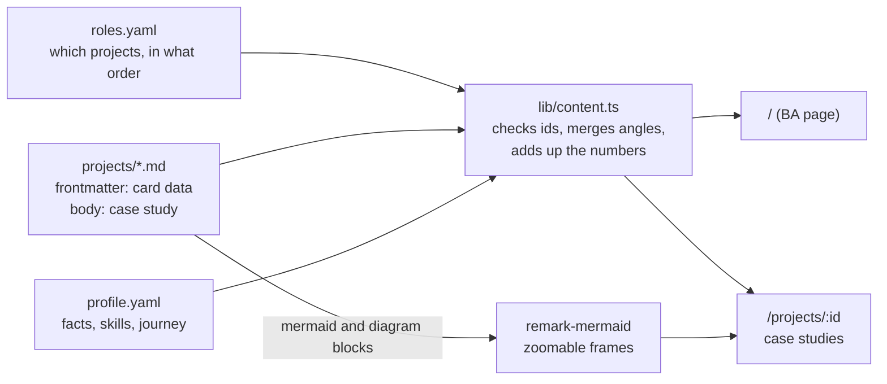
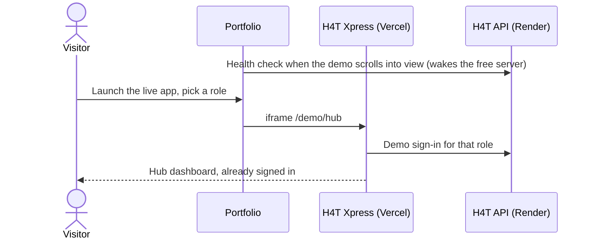

# thiens-portfolio

Personal portfolio of **Nguyen Duc Thien**, Information Systems student at UEL (VNU-HCM), aiming for IT Business Analyst roles.

**Live: https://thiens-portfolio.vercel.app**

Every project is told the way a BA would present it: the business problem, my role, the key workflow as a zoomable diagram, the BA artifacts (spec, BPMN, use cases, traceability) with links to the real files, the numbers behind them, and the product that came out of it. The featured project, [H4T Xpress](https://github.com/thienAG4/h4t-xpress), runs live inside the page: pick a role and the app opens already signed in.

## What is on the page

| Section | What it shows | Source |
|---|---|---|
| Hero | Headline, "how I work" pipeline, totals added up from the projects (requirements, use cases, BPMN, live products) | `roles.yaml` + project metrics |
| About | Short story, monogram with orbiting skills, key facts | `roles.yaml`, `profile.yaml` |
| Work | Featured project with the live app, then one card per project with its key workflow | `projects/*.md` |
| Case studies | Full write-ups with sequence and state diagrams, BPMN, ERD and screenshots | Markdown body of a project |
| Skills, Journey, Contact | Skill groups, timeline, e-mail with copy button and local time | `profile.yaml` |

## How it works



- **Content is data** (decision D2). Changing a text, a number or the project order for a job application means editing YAML or Markdown, not components.
- **One page per role** (decision D3). `roles.yaml` lists each role's path and its `featured` projects. A project has a `default` story and optional `angles.<role>` that override any field for that role. Today only the BA page (`/`) exists.
- **The build checks the data.** Schemas live in `src/content.config.ts`. A typo in a project id, an unknown icon or a wrong type stops the build with a clear message instead of silently hiding something.



## Project structure

```
thiens-portfolio/
├── astro.config.ts              # static output, Tailwind, Markdown processor with remark-mermaid
├── public/
│   ├── images/                  # screenshots, BPMN, DFD, ERD and use case diagrams (WebP)
│   ├── favicon.svg
│   └── og.png                   # link preview image
├── src/
│   ├── content.config.ts        # schemas for roles, profile and projects
│   ├── content/
│   │   ├── roles.yaml           # one entry per role page (ba at "/")
│   │   ├── profile.yaml         # facts, skills, journey
│   │   └── projects/            # one Markdown file per project
│   ├── lib/
│   │   ├── content.ts           # role view: id checks, angle merge, totals
│   │   ├── diagram-markup.ts    # markup of a zoomable diagram frame
│   │   ├── remark-mermaid.ts    # ```mermaid and ```diagram blocks -> frames
│   │   └── icons.ts             # lucide icons as inline SVG
│   ├── components/              # Hero, About, Spotlight, LiveDemo, ProjectCard, Skills, Journey...
│   ├── layouts/Base.astro       # head, backdrop glow, grain overlay, nav, footer
│   ├── pages/                   # index, [role], projects/[id], 404
│   ├── scripts/
│   │   ├── diagrams.ts          # draws Mermaid on demand, full-screen view
│   │   ├── panzoom.ts           # drag, pinch, Ctrl + wheel, keyboard zoom
│   │   ├── live-demo.ts         # warm-up call, role tabs, scaled iframe
│   │   └── motion.ts            # reveals, count-up, nav state, copy e-mail, clock
│   └── styles/global.css        # theme tokens, glass, grain, diagram and prose styles
└── docs/DECISIONS.md            # decision log from the planning interview
```

## Edit the content

| I want to... | Edit |
|---|---|
| Change the headline, intro or availability | `src/content/roles.yaml` |
| Reorder or hide projects | `featured` in `roles.yaml` |
| Change a project's story, numbers or artifact links | the project's frontmatter in `src/content/projects/` |
| Tell a project differently for one role | add `angles.<role>` with only the fields that change |
| Add a diagram to a case study | a ` ```mermaid title="..." ` block, or ` ```diagram src="/images/..." title="..." ` for an exported image |
| Add a role page such as `/dev` | a new entry in `roles.yaml` with `path: /dev` |

## Run locally

Requires **Node.js 22.23.4 or newer** (Astro 7).

```bash
npm install
npm run dev       # http://localhost:4321
npm run build     # type and content checks, then the static site in dist/
```

If your installed Node is older, run Astro through a matching Node without changing it:

```bash
npx -y node@22.23.4 node_modules/astro/bin/astro.mjs dev
```

## Stack

Astro 7 (static), Tailwind CSS 4, Mermaid 12 (loaded only when a diagram is near the screen), Inter and Plus Jakarta Sans (self-hosted), lucide icons. Deployed on Vercel. The design takes its palette (#101E21, #34404C, #6881F5) from a Behance landing page concept, with a grain overlay and frosted glass surfaces.
