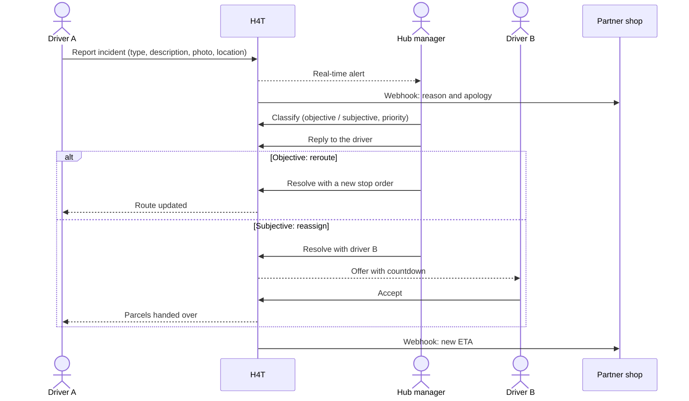
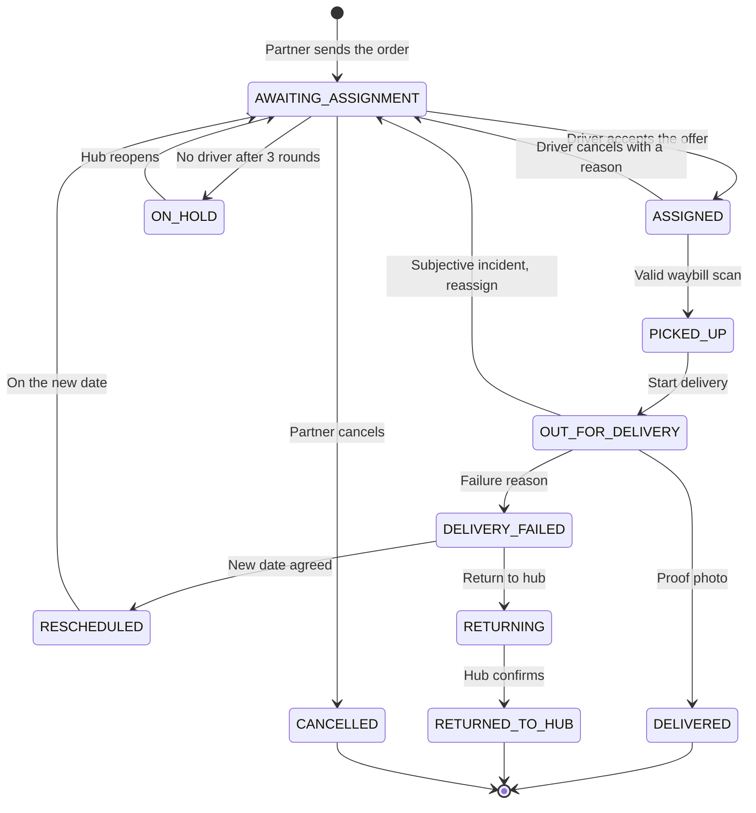

## Context

- **The company:** last-mile delivery. Parcels arrive at a hub, drivers take them out, an e-commerce partner informs its customers.
- **The project:** 5-person analysis in Systems Analysis and Design (UEL). I led the group.
- **After the course:** I built the spec into a working product to see if the requirements held up.

## The problem (as-is)

- The driver has **no standard channel** to report it. They call the hub, and the call is the only record.
- The hub manager spends **15 to 20 minutes on the phone** finding a replacement driver.
- The customer and the shop **never get a new ETA** or a reason for the delay.

## Who uses it

| Role | Interface | Sees |
|---|---|---|
| Driver | Mobile web app | Only their own orders, route and incidents |
| Hub manager | Desktop dashboard | Only the hub they manage |
| Executive | Reports | Aggregated figures for every hub, read only |
| System admin | Admin console | Accounts, permissions and settings, no operations |
| Partner and customer | Partner's own site | Status, ETA and delay reasons sent by webhook |

Customers have **no account** in H4T: per our report's scope, updates reach them through the partner.

## To-be: incident handling

**Classify → reply → choose a solution**, in that order. A skipped step is blocked with the exact message from our report.



**Auto-detected incidents (BR12):** ETA slips 3 times in a row, or a driver on delivery barely moves.

## Order lifecycle

**BR3:** only these transitions are allowed. Every change logs who, when and where.



## Dispatch rules

Finding a replacement used to take 20 minutes, so it got the most precise rules.

- **Eligible (BR4):** 8 filters: active account, shift today, online, fresh GPS, same hub, under the order limit, no pending offer, no earlier refusal.
- **Ranked (BR5):** score 0-100, weights tunable in settings without a release.
- **Offered (BR6-BR8):** one driver at a time, timeout = refusal, 3 empty rounds → on hold + alert.

| Criterion | Measure | Weight |
|---|---|:-:|
| Distance | Closer to the pickup point scores higher, zero beyond 15 km | 40% |
| Current load | Active orders against the driver's limit | 25% |
| History | 70% on-time rate plus 30% incident-free rate over 30 days | 20% |
| Time fit | Whether the rest of the shift covers the delivery | 15% |

## Requirements at a glance

| Group | Covers | Count |
|---|---|:-:|
| FR-S | Receiving, checking and cancelling partner orders | 3 |
| FR-D | Driver: shifts, availability, offers, scanning, status, incidents | 6 |
| FR-H | Hub: reassignment, live tracking, rerouting and more | 6 |
| FR-J | Automatic jobs: dispatch, ETA, partner sync | 3 |
| FR-R | Reports and exports | 6 |
| FR-A | Accounts, permissions, sign-in, configuration | 5 |
| NFR | Performance, security, availability, accessibility... | 10 |

Use cases with full specifications: UC-01 register for a shift, UC-02 follow delivery progress, UC-03 adjust a route, UC-04 reassign an order, UC-05 update delivery status.

## From requirement to test

Excerpt of the [traceability matrix](https://github.com/thienAG4/h4t-xpress/blob/main/docs/traceability.md) (requirement → code → test):

| Requirement | Screen | Automated check |
|---|---|---|
| FR-D-06 Report an incident | Driver: report incident | Rejects a report without a description or evidence |
| FR-H-01 / UC-04 Reassign an order | Hub: candidate picker | Parcels are handed over to another driver |
| FR-H-03 / UC-03 Adjust a route | Hub: route planning | The stop order changes after a reroute |
| FR-R-01..05 Reports | Executive dashboard | Numbers match, and a hub manager only sees their own hub |

## When the spec met the code

Building it showed where the spec was vague. **35 changes** went back into the spec, each numbered with its reason. Three examples:

- **Missing state:** a problem right after the hub scan had no way back from `PICKED_UP`. Added one transition.
- **Hub before automation:** auto offers blocked manual picks. Manual offers now take priority.
- **No driver at night:** no longer burns a dispatch round; orders wait instead of going on hold.
- **Honest limits:** the 99% uptime NFR is marked **not met** on free hosting.

## Screens

```diagram src="/images/h4t-xpress/hub-incident.webp" title="Hub · incident review" height=440
Classify, reply, then choose a solution. Each step is required.
```

```diagram src="/images/h4t-xpress/hub-route-planning.webp" title="Hub · route planning" height=440
Road routes from OSRM with a suggested stop order.
```

```diagram src="/images/h4t-xpress/driver-incident.webp" title="Driver · report an incident" height=560
Type, description and at least one photo are mandatory.
```

```diagram src="/images/h4t-xpress/reports.webp" title="Executive · reports" height=440
Success rate, on-time rate and failure causes, exportable to Excel and PDF.
```

## Credits

Business analysis and UI design (survey, BPMN, DFD, use cases, ERD, Figma) by Group 11, Information Systems Analysis and Design (UEL): Nguyen Duc Thien (lead), Le Quang Huy, Do Hai Thuan, Mai The Thu, Nguyen Tan Trong. Supervisor: Trieu Viet Cuong.
